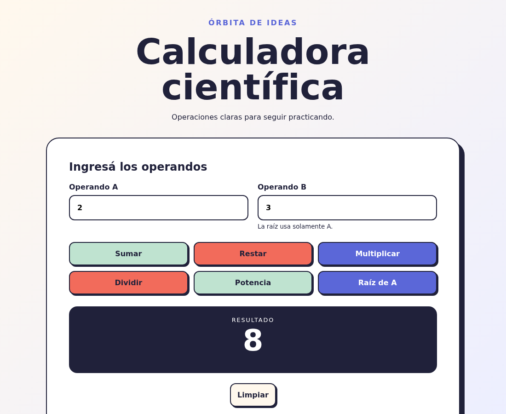

# Calculadora científica — Órbita de Ideas

Calculadora responsive con operaciones básicas, potencia y raíz cuadrada, implementada sin dependencias.

## Datos generales

- Estudiante: Hodaia Yemal
- Tecnologías: HTML, CSS y JavaScript
- Sketch local: [`evidencias/sketch-calculadora.drawio`](evidencias/sketch-calculadora.drawio)
- Documentación completa: [`documentacion.md`](documentacion.md)

## Prompts utilizados

### Prompt 1

```text
Implementá una calculadora educativa responsive para Órbita de Ideas en index.html, style.css y script.js. Incluí dos campos numéricos, suma, resta, multiplicación, división, resultado, mensaje accesible y limpiar. No uses eval. Conservá la paleta #FFF8ED, #20213A, #5B67D8, #F26B5B y #BFE3D0 y los IDs especificados en el sketch.
```

### Prompt 2

```text
Agregá potencia usando ambos operandos y raíz cuadrada usando solo el primero. Validá división por cero, raíz negativa, campos requeridos y resultados no finitos. Enter desde un campo debe ejecutar suma sin recargar la página.
```

### Prompt 3

```text
La prueba 0.1 + 0.2 expone el artefacto 0.30000000000000004 en pantalla. Conservá el cálculo numérico y agregá una función de presentación que limite el resultado a 12 cifras significativas, elimine ceros innecesarios y muestre 0.3. Exportá esa función para probarla sin modificar las validaciones existentes.
```

## Pruebas

Se verificaron suma, resta, multiplicación, división, potencia, raíz, decimales, limpiar, campos vacíos, división por cero, raíz negativa y resultados no finitos.

```bash
node --test tests/calculator.test.js
node --check script.js
```

## Evidencia



## Ejecución

Abrir `index.html` en el navegador. Enter desde un operando ejecuta la suma.
