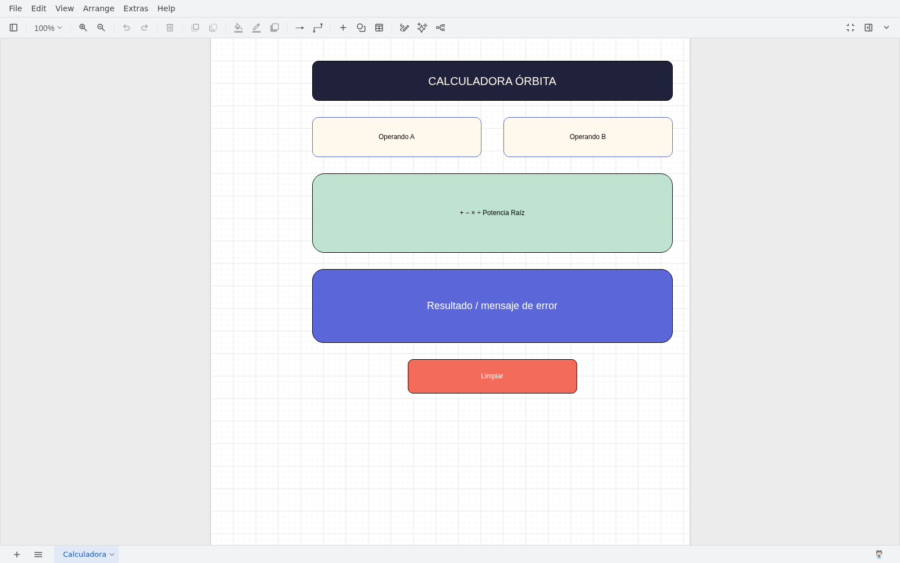
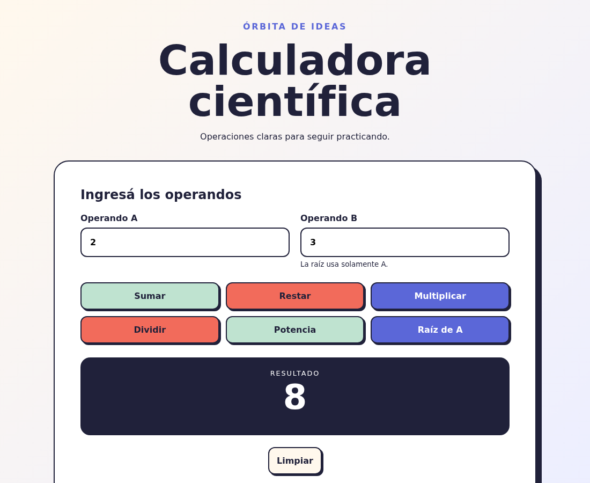

# Calculadora científica — Órbita de Ideas

## Datos generales y sketch

- Estudiante: Hodaia Yemal
- Tecnologías: HTML, CSS y JavaScript
- Repositorio: https://github.com/2023hodaiayemal-netizen/calculadora-cientifica
- Sketch previo: `evidencias/sketch-calculadora.png`

**Evidencia del editor:** captura auténtica del archivo abierto en diagrams.net/moqups.



## Planeamiento

Dos operandos, cuatro operaciones básicas, potencia y raíz cuadrada. La raíz usa solo el primer operando. Se validan campos vacíos, división por cero, raíz negativa y resultados no finitos.

## Prompts utilizados

### Prompt 1 — estructura y operaciones básicas

```text
Implementá una calculadora educativa responsive para Órbita de Ideas en index.html, style.css y script.js. Incluí dos campos numéricos, suma, resta, multiplicación, división, resultado, mensaje accesible y limpiar. No uses eval. Conservá la paleta #FFF8ED, #20213A, #5B67D8, #F26B5B y #BFE3D0 y los IDs especificados en el sketch.
```

### Prompt 2 — operaciones científicas

```text
Agregá potencia usando ambos operandos y raíz cuadrada usando solo el primero. Validá división por cero, raíz negativa, campos requeridos y resultados no finitos. Enter desde un campo debe ejecutar suma sin recargar la página.
```

### Prompt 3 — corrección real

```text
La prueba 0.1 + 0.2 expone el artefacto 0.30000000000000004 en pantalla. Conservá el cálculo numérico y agregá una función de presentación que limite el resultado a 12 cifras significativas, elimine ceros innecesarios y muestre 0.3. Exportá esa función para probarla sin modificar las validaciones existentes.
```

## Pruebas y diferencias

| Versión | Cambio | Motivo |
| --- | --- | --- |
| v1 | Operaciones básicas, limpiar, resultado y errores. | Primer prompt. |
| v2 | Potencia, raíz y ejecución de suma con Enter. | Segundo prompt. |
| v3 | Formato de hasta 12 cifras significativas. | Evitar el artefacto visual real de `0.1 + 0.2`. |

Resultados verificados el 24/11/2026: `2 + 3 = 5`, `2 − 5 = −3`, `−4 × 2 = −8`, `7 ÷ 2 = 3.5`, `2³ = 8`, `√9 = 3` y `1.5 + 2.25 = 3.75`. Se rechazaron división por cero, raíz negativa, campos vacíos y resultados no finitos. Limpiar reinicia campos, resultado y mensaje.

Comandos ejecutados:

```text
node --test tests/calculator.test.js
node --check script.js
```

## Evidencia



## Estado

- [x] Sketch local
- [x] Tres prompts iterativos
- [x] Corrección real documentada
- [x] Operaciones y validaciones probadas
- [x] PDF local generado
